<div align="center">

[](https://reviewradar-nlp.streamlit.app/)

**🔗 Live Streamlit URL:** https://reviewradar-nlp.streamlit.app/ 


<br>

[](#)
[](#)
[](https://www.kaggle.com/datasets/nicapotato/womens-ecommerce-clothing-reviews)
[](#-results-comparison)

<br>


</div>

<br>

## 🖥️ App Preview

<div align="center">

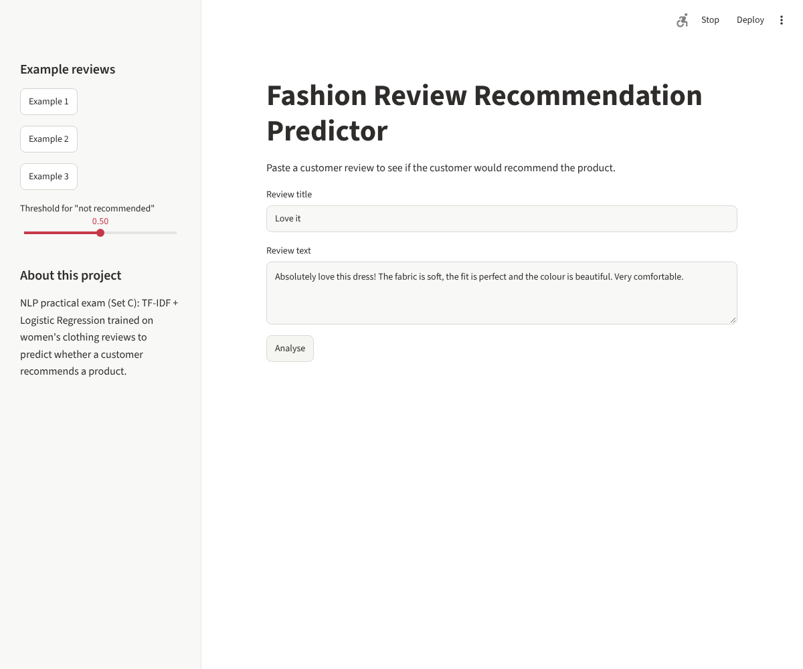

*The Streamlit app: review title, review text, example buttons, threshold slider and Analyse button.*

</div>

<br>

## 🎬 Video Walkthrough

<div align="center">

[](https://drive.google.com/file/d/1YdgfaOQ3YFVllaN52xzrpA1M39PIbKhL/view?usp=sharing)

🎥 **A complete video explanation (face + screen, 5–10 min)** covering text preprocessing and RegEx, BoW vs TF-IDF vs N-grams, CBoW vs Skip-gram, the classification pipeline and threshold choice, heuristic vs VADER vs ML, POS tagging, why vectorisers are fitted on training data only, and a **live demo of the Streamlit app**.

> 📌 *Click the button above or [open the video directly →](https://drive.google.com/file/d/1YdgfaOQ3YFVllaN52xzrpA1M39PIbKhL/view?usp=sharing)*

</div>

---

## 🎯 About This Project

> Every returned parcel costs money, and many returns are announced in advance in the customer's own words: *"runs very small"*, *"fabric feels cheap"*, *"would not buy again"*. This project teaches a model to read those words.

The system reads a fashion review and predicts whether the customer **would recommend the product**, so the quality team can look at risky products first. It compares **three approaches** on the same test reviews: hand-written rules, a ready-made sentiment tool (VADER), and machine-learning models built on **Bag-of-Words, TF-IDF, N-Grams and Word2Vec**. The best pipeline is saved and deployed as a Streamlit web app.

<div align="center">

```
░░░░░░░░░░░░░░░░░░░░░░░░░░░░░░░░░░░░░░░░░░░░░░░░░░░░░░░░░░░
   Raw reviews → Missing text → Train/Test split → RegEx
   ───────────────────────────────────────────────────────
   Tokenise → Stop-words → Lemmatize → clean_text()
   ───────────────────────────────────────────────────────
   BoW → TF-IDF → N-grams → Word2Vec (CBoW / Skip-gram)
   ───────────────────────────────────────────────────────
   Heuristic  |  VADER (API-style)  |  Logistic Regression
   ───────────────────────────────────────────────────────
   Threshold → POS phrases → Saved pipeline → Streamlit app
░░░░░░░░░░░░░░░░░░░░░░░░░░░░░░░░░░░░░░░░░░░░░░░░░░░░░░░░░░░
```

</div>

<br>

---

## 📚 Dataset

| Item | Detail |
|:---|:---|
| **Name** | Women's E-Commerce Clothing Reviews |
| **Source** | [Kaggle – nicapotato/womens-ecommerce-clothing-reviews](https://www.kaggle.com/datasets/nicapotato/womens-ecommerce-clothing-reviews) |
| **File** | `Womens Clothing E-Commerce Reviews.csv` (not stored in this repository, download it from Kaggle) |
| **Size** | 23,486 reviews, **22,641** left after dropping reviews with no text |
| **Columns used** | `Title`, `Review Text`, `Rating`, `Recommended IND`, `Department Name` |
| **Target** | `Recommended IND` → 1 = recommends, **0 = does not recommend** (minority class, about **18.1%**) |
| **Split** | 80 / 20 stratified (18,112 train / 4,529 test), `random_state=42`, done **before** fitting any vectoriser |
| **Main metrics** | **Recall and F1 of class 0** and **ROC-AUC** (accuracy alone is misleading on imbalanced data) |

<br>

---

## ✨ What Makes This Project Stand Out

<table>
<tr>
<td width="50%" valign="top">

### 🧹 Careful Text Cleaning
- Missing review text dropped, missing titles filled, `Title + Review Text` joined
- RegEx patterns for sizes, heights, `!` counts and ALL-CAPS words
- `not`, `no` and `nor` **kept** as stop-words, so "not comfortable" is never turned into "comfortable"

</td>
<td width="50%" valign="top">

### 🔒 No Data Leakage
- Train/test split done **first**
- Every `CountVectorizer`, `TfidfVectorizer` and `Word2Vec` fitted on **training reviews only**
- Test reviews are only transformed or predicted

</td>
</tr>
<tr>
<td width="50%" valign="top">

### 📊 Fair Comparison
- Baseline, four ML models, heuristic and VADER on the **same** test data
- Judged by recall of the unhappy class and ROC-AUC
- Decision-threshold table for the quality team

</td>
<td width="50%" valign="top">

### 🚀 Real Deployment
- One shared `text_utils.py` used by notebook **and** app
- Threshold slider, RegEx statistics and POS phrases in the app
- Handles empty input with a clear warning

</td>
</tr>
</table>

<br>

---

## 🗺️ Full Project Journey

<div align="center">

| Step | Focus | Key Output |
|:---:|:---|:---|
| 🧠 **Step 1** | Fundamentals, preprocessing, RegEx | Missing-text handling · 4 EDA plots · RegEx patterns · `clean_text()` · stemming vs lemmatization |
| 🔢 **Step 2** | BoW, TF-IDF, N-grams | Tiny-corpus matrices · features on real reviews · sparsity table |
| 🧬 **Step 3** | Word2Vec | CBoW and Skip-gram · similar words · PCA plot · saved Skip-gram model |
| 🎯 **Step 4** | Classification pipeline | Baseline + 4 models · ROC curves · confusion matrix · thresholds · saved `.pkl` |
| 🔍 **Step 5** | Heuristic vs VADER vs ML, POS tagging | Comparison table · complaint-phrase chart |
| 🚀 **Step 6** | Streamlit app | Local app · screenshots · deployment |
| 📊 **Step 7** | Summary, reflection, submission | Results table · reflection · `summary_report.md` |

</div>

<br>

---

## 🔄 Pipeline Summary

<div align="center">

| Stage | What was done on the reviews |
|:---:|:---|
| 1️⃣ Data collection | Load CSV, keep 5 columns, drop reviews with no text |
| 2️⃣ Splitting | 80 / 20 stratified split before any fitting |
| 3️⃣ Text cleaning | Lowercase, expand `n't`, keep letters only |
| 4️⃣ Tokenisation | NLTK `word_tokenize` |
| 5️⃣ Stop-words | NLTK list, but `not`, `no`, `nor` are kept |
| 6️⃣ Lemmatization | NLTK `WordNetLemmatizer` |
| 7️⃣ Features | BoW, TF-IDF, TF-IDF + bigrams, averaged Word2Vec |
| 8️⃣ Model | Logistic Regression with `class_weight='balanced'` |
| 9️⃣ Evaluation | Recall / precision / F1 of class 0, ROC-AUC, confusion matrix |
| 🔟 Deployment | Saved `joblib` pipeline inside a Streamlit app |

</div>

<br>

---

## 🧠 The Key Ideas

### 🔎 Exploring the reviews
Only about **18%** of customers do not recommend the product, so a model that always says "recommends" already scores **81.9%** accuracy while catching **zero** unhappy customers. That is why recall of the minority class is the main measure.

<div align="center">

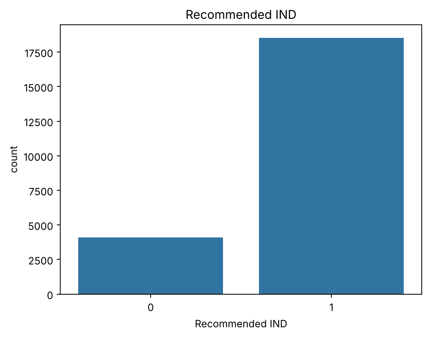

*The classes are imbalanced: far more customers recommend than do not.*

<br><br>

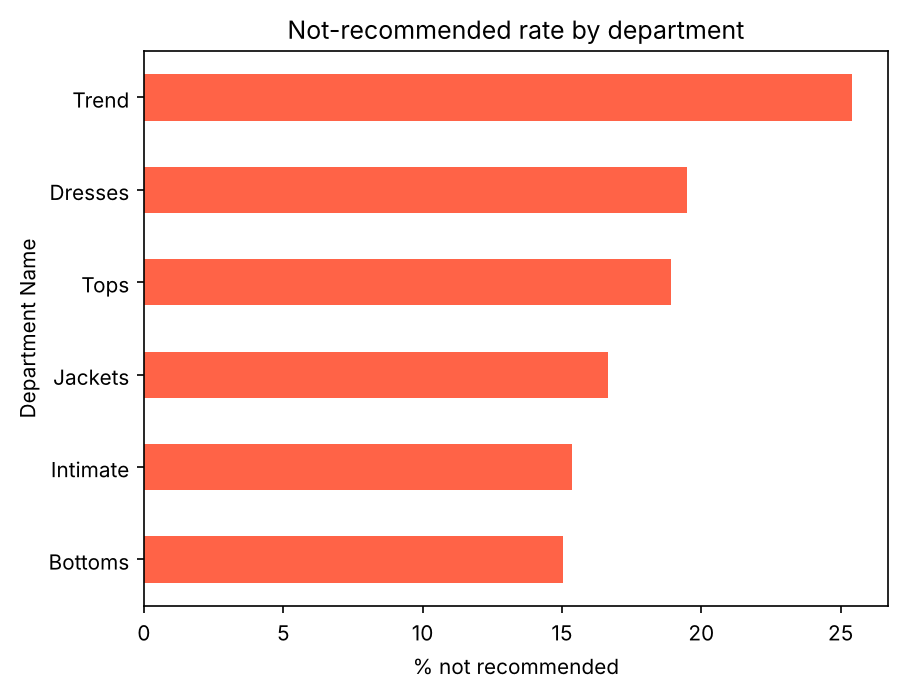

*The **Trend** department has the highest not-recommended rate (25.4%), so it needs the quality team's attention first.*

<br><br>

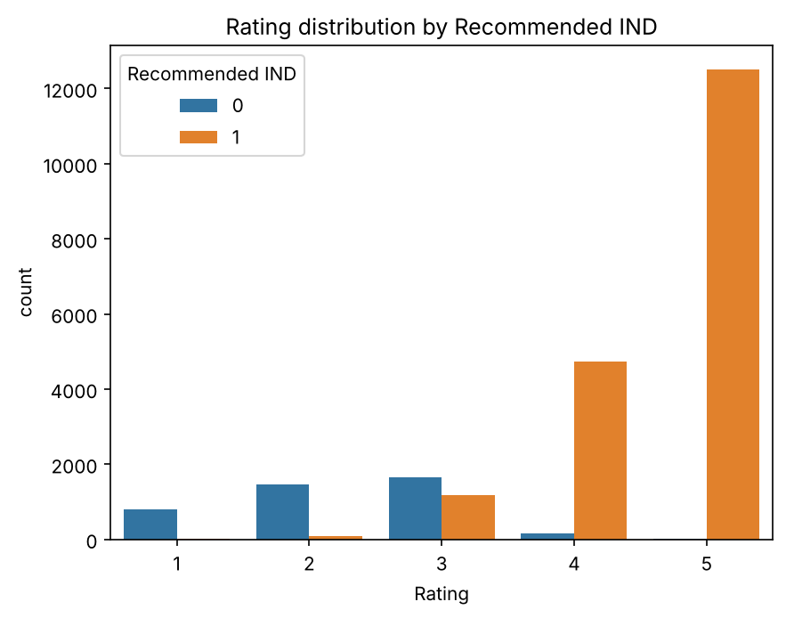

*High ratings are mostly recommended and low ratings mostly not, but the middle ratings are mixed.*

</div>

### 🧹 Cleaning and word frequency
RegEx removes noise, `not`/`no`/`nor` are kept so negation survives, and lemmatization reduces words to their base form. After cleaning, the most frequent words of each class show what customers talk about.

<div align="center">

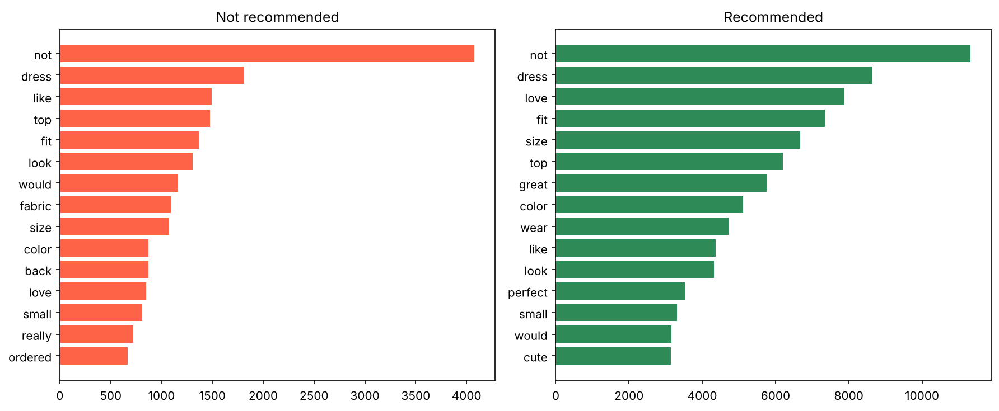

*Top 15 words in not-recommended (left) and recommended (right) reviews.*

</div>

### 🔢 BoW, TF-IDF and N-grams
Bag-of-Words counts words, TF-IDF down-weights words that appear in many reviews, and bigrams keep short phrases such as **"not worth"**. On the real reviews, both BoW and TF-IDF use 5,000 features with about **99.5% sparsity**.

### 🧬 Word2Vec
CBoW predicts a word from its context; Skip-gram predicts the context from a word. Both were trained on the training reviews only (vocabulary of **3,910** words, 100 dimensions). Words used in similar contexts, such as *small* and *tight*, get similar vectors.

<div align="center">

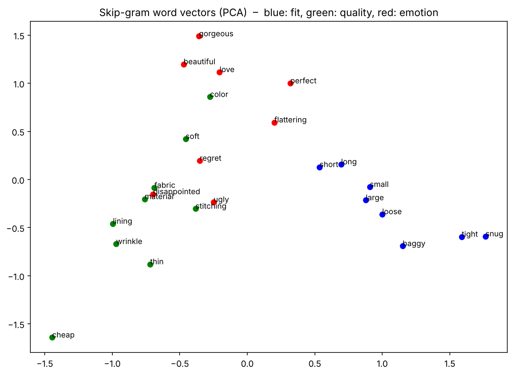

*PCA plot of 25 fit, quality and emotion words (Skip-gram vectors).*

</div>

### 🏷️ POS tagging
A part-of-speech tagger labels each word as noun, verb, adjective and so on, using the word and its neighbours. Here it is used to pull out **adjective + noun** complaint phrases from not-recommended reviews.

<div align="center">

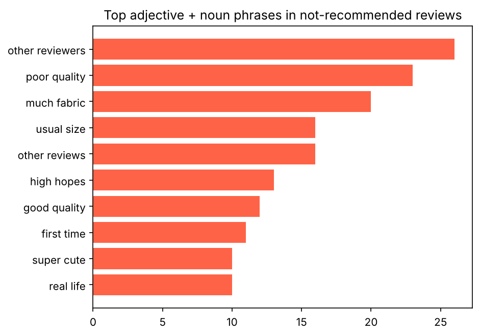

*The 10 most frequent adjective + noun phrases in 1,000 not-recommended reviews.*

</div>

<br>

---

## 📊 Results Comparison

### Four ML models vs the baseline (test set, class 0 = not recommended)

| Model | Accuracy | Precision (0) | Recall (0) | F1 (0) | ROC-AUC |
|:---|:---:|:---:|:---:|:---:|:---:|
| Baseline (always "recommends") | 0.819 | 0.000 | 0.000 | 0.000 | 0.500 |
| A: Bag-of-Words | 0.884 | 0.646 | 0.794 | 0.713 | 0.925 |
| B: TF-IDF | 0.879 | 0.617 | 0.871 | 0.722 | 0.944 |
| **C: TF-IDF + N-grams** | **0.890** | **0.643** | **0.877** | **0.742** | **0.948** 🏆 |
| D: Averaged Word2Vec | 0.866 | 0.586 | 0.885 | 0.706 | 0.941 |

<div align="center">

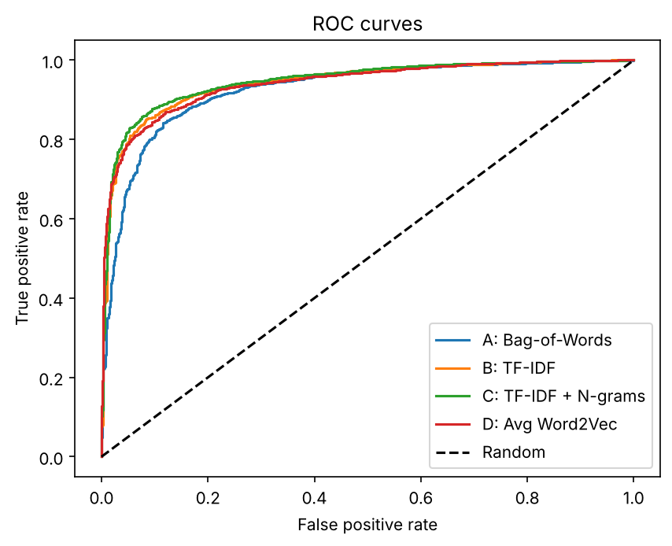

*ROC curves of the four models: TF-IDF + N-grams sits highest.*

<br><br>

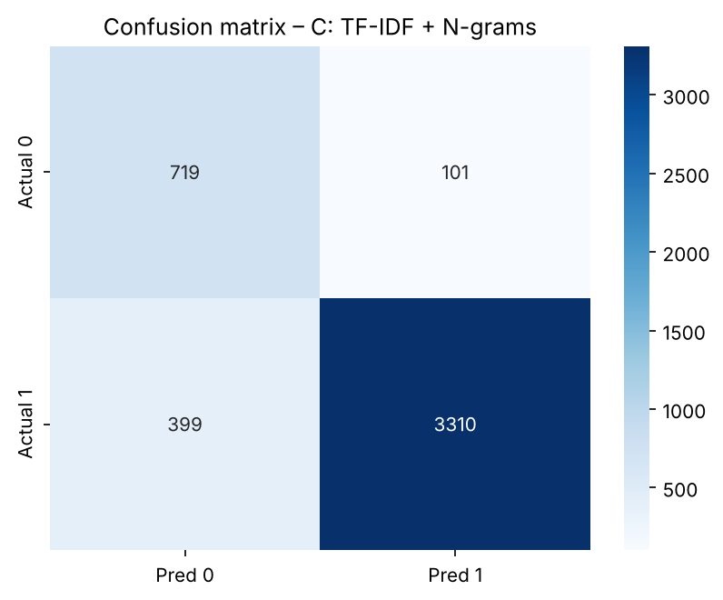

*Confusion matrix of the best model on the test set.*

</div>

**Deployed model:** `TfidfVectorizer(ngram_range=(1,2), max_features=10000)` + `LogisticRegression(class_weight='balanced')`.
`class_weight='balanced'` makes mistakes on the small class count more, lifting recall of unhappy customers from **0.00** (baseline) to **0.88**.

### 🎚️ Decision threshold (best model)

| Threshold | Precision (0) | Recall (0) | Reviews flagged |
|:---:|:---:|:---:|:---:|
| 0.3 | 0.506 | 0.961 | 1,557 |
| 0.5 | 0.643 | 0.877 | 1,118 |
| 0.7 | 0.765 | 0.679 | 728 |

A lower threshold catches more unhappy customers but gives the quality team more reviews to check.

### ⚖️ Three approaches on the same 1,000 test reviews

| Approach | Needs training data? | Accuracy | Recall (0) | F1 (0) |
|:---|:---:|:---:|:---:|:---:|
| Heuristic (15 warning words) | No | 0.783 | 0.390 | 0.396 |
| VADER (threshold tuned on 1,000 train reviews) | No | 0.840 | 0.324 | 0.424 |
| **ML (TF-IDF + N-grams + Logistic Regression)** | Yes | **0.890** | **0.879** | **0.744** 🏆 |

The heuristic and VADER need no training and are easy to explain, but they ignore context. The ML pipeline learns from labelled reviews and clearly wins on recall and F1.

<br>

---

## 📸 App Screenshots

<table>
<tr>
<td align="center" width="50%">

<br><sub><b>Positive review</b> – customer would recommend ✅</sub>
</td>
<td align="center" width="50%">
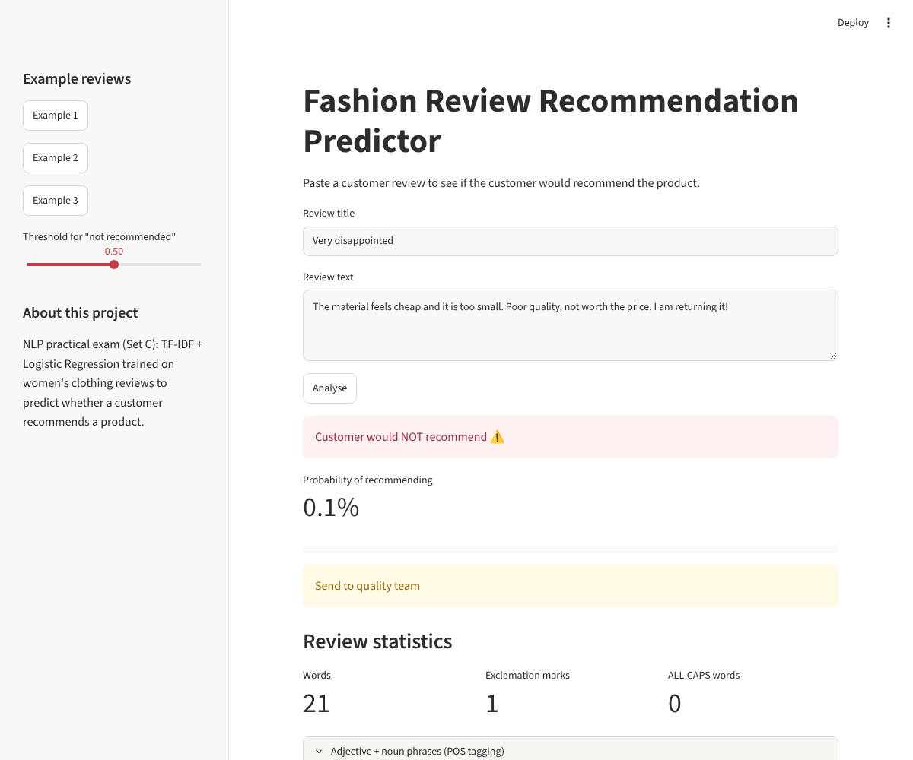
<br><sub><b>Negative review</b> – "Send to quality team" warning</sub>
</td>
</tr>
<tr>
<td align="center" width="50%">
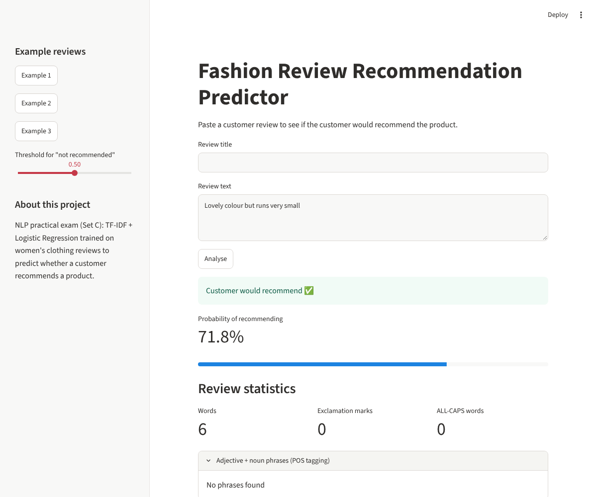
<br><sub><b>Mixed review</b> – "lovely colour but runs very small"</sub>
</td>
<td align="center" width="50%">
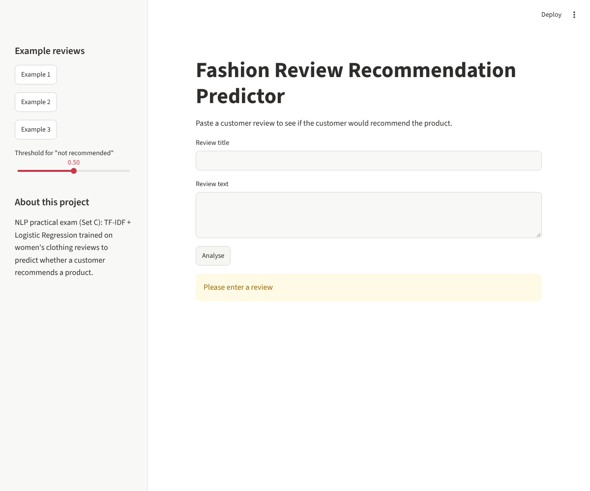
<br><sub><b>Empty input</b> – "Please enter a review"</sub>
</td>
</tr>
</table>

### 🛡️ App Features
- Review title and review text inputs with an **Analyse** button
- Result message, **probability of recommending** (metric + progress bar)
- **"Send to quality team"** warning when the probability of not recommending is above 0.5
- RegEx statistics: word count, exclamation marks, ALL-CAPS words
- Sidebar with 3 example reviews, a threshold slider and an "About" note
- Expander showing adjective + noun phrases found with POS tagging
- Empty input handled with `st.warning('Please enter a review')`

<br>

---

## ▶️ How to Run Locally

```bash
# 1. Clone the repository
git clone https://github.com/YOUR-USERNAME/nlp-practical-exam-set-c.git
cd nlp-practical-exam-set-c

# 2. Install the requirements
pip install -r requirements.txt

# 3. Start the app
streamlit run app.py
```

To re-run the notebook, download the CSV from [Kaggle](https://www.kaggle.com/datasets/nicapotato/womens-ecommerce-clothing-reviews), place it next to `NLP_Practical_Exam_SetC.ipynb` and run **Restart & Run All**. The notebook creates `text_utils.py`, `recommend_pipeline.pkl`, `word2vec_skipgram.model` and the `images/` folder.

<br>

---

## 📁 Repository Structure

```
├── NLP_Practical_Exam_SetC.ipynb  # Steps 1-5 (full analysis, executed)
├── app.py                         # Streamlit app
├── text_utils.py                  # clean_text() shared by notebook and app
├── recommend_pipeline.pkl         # saved scikit-learn pipeline
├── word2vec_skipgram.model        # saved Skip-gram model (+ .npy files)
├── requirements.txt               # pinned versions
├── summary_report.md              # ~1 page results + reflection
├── README.md
├── images/                        # graphs from the notebook
└── outputs/                       # Streamlit screenshots
```

<br>

---

## 🧪 What This Project Covers (Theory)

<details>
<summary><b>📖 Click to expand – NLP Concepts Covered</b></summary>
<br>

- What NLP is, its applications, challenges and pipeline stages
- Handling missing text, RegEx patterns and `re.sub()`
- Tokenisation, stop-words (keeping negations) and lemmatization
- Stemming vs lemmatization and why POS matters
- Bag-of-Words, TF-IDF and N-grams, fitted on training data only
- Word embeddings, Word2Vec, CBoW and Skip-gram
- Text classification, imbalanced data and `class_weight='balanced'`
- Recall, precision, F1, ROC-AUC, confusion matrix and decision thresholds
- Heuristic, API-style (VADER) and machine-learning approaches
- POS tagging, rule-based vs statistical taggers
- Data leakage and deployment with Streamlit

</details>

<br>

---

## 🛠️ Tools & Versions

| Tool | Used For | Version |
|:---|:---|:---:|
| Python / Jupyter Notebook | Development | 3.12.3 |
| pandas / NumPy | Data handling | 3.0.6 / 2.5.4 |
| NLTK | Tokenisation, stop-words, lemmatization, VADER, POS tagging | 3.10.4 |
| scikit-learn | Vectorisers, Logistic Regression, metrics, pipeline | 1.9.1 |
| Gensim | Word2Vec (CBoW and Skip-gram) | 4.4.0 |
| Matplotlib / Seaborn | Plots | 3.11.2 / 0.13.2 |
| Streamlit | Web app and deployment | 1.67.0 |

> The same `scikit-learn` version must be used for training and deployment, because a model saved with one version may not load in another. Exact versions are in `requirements.txt`.

<br>

---

## 👨‍💻 Author

<div align="center">

### **Ayush Isamaliya**
*Data Science & NLP Learner*

</div>

### 🌐 Connect With Me

<div align="center">

[]()
[]()

</div>

<br>

<div align="center">


**Built as part of the NLP track at Red & White Skill Education**


*Made with ❤️ | NLP Practical Exam Set C | From Raw Reviews to a Deployed App*

</div>
